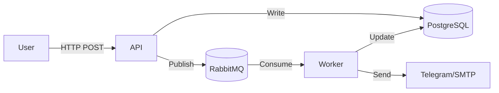

# NotifyService

## 1. Описание проекта
Необходимо разработать сервис для асинхронной отправки уведомлений пользователям. Сервис должен принимать запросы через HTTP API, помещать их в очередь сообщений, а отдельный воркер должен забирать задачи из очереди и отправлять уведомления (Email или Telegram).

**Главная цель:** Изучить работу с очередями сообщений (RabbitMQ), понять паттерн Producer-Consumer, реализовать обработку ошибок и повторные попытки (retry).

---

## 2. Стек технологий
| Компонент            | Технология              |
| :------------------- | :---------------------- |
| **Язык**             | Go                      |
| **Брокер сообщений** | RabbitMQ                |
| **База данных**      | PostgreSQL              |
| **Контейнеризация**  | Docker & Docker Compose |
| **HTTP Фреймворк**   | Gin / Echo / Chi        |
| **Конфигурация**     | ENV                     |

---

## 3. Архитектура
Система состоит из двух частей (могут быть в одном репозитории):
1.  **API Service (Producer):** Принимает HTTP запросы, валидирует их, сохраняет статус в БД и отправляет задачу в RabbitMQ.
2.  **Worker Service (Consumer):** Слушает очередь RabbitMQ, отправляет уведомление через внешний провайдер (SMTP/Telegram), обновляет статус в БД.

---

## 4. База данных (PostgreSQL)
Необходимо создать таблицу для хранения истории уведомлений.

**Таблица: `users`**

| Поле              | Тип              | Ограничения                                      | Описание                                      |
|-------------------|------------------|--------------------------------------------------|-----------------------------------------------|
| `id`              | BIGINT           | PRIMARY KEY, GENERATED ALWAYS AS IDENTITY       | Уникальный ID                                 |
| `full_name`       | VARCHAR(100)     | NOT NULL                                         | Имя пользователя                              |
| `email`           | VARCHAR(255)     | NOT NULL, UNIQUE                                 | Почта (для логина и уведомлений)              |
| `password_hash`   | VARCHAR(255)     | NOT NULL                                         | Хеш пароля (bcrypt/argon2)                    |
| `telegram_chat_id`| VARCHAR(100)     | UNIQUE                                           | ID для отправки в Telegram (nullable)         |
| `phone`           | VARCHAR(20)      | UNIQUE                                           | Номер для SMS (nullable)                      |
| `is_active`       | BOOLEAN          | NOT NULL, DEFAULT TRUE                           | Активен ли пользователь                       |
| `created_at`      | TIMESTAMPTZ      | NOT NULL, DEFAULT NOW()                          | Время создания                                |
| `updated_at`      | TIMESTAMPTZ      | NOT NULL, DEFAULT NOW()                          | Время обновления                              |

**Таблица: `notifications`**

| Поле             | Тип                    | Ограничения                                              | Описание                                           |
|------------------|------------------------|----------------------------------------------------------|----------------------------------------------------|
| `id`             | BIGINT                 | PRIMARY KEY, GENERATED ALWAYS AS IDENTITY               | Уникальный ID                                      |
| `user_id`        | BIGINT                 | NOT NULL, FK → `users(id)`                               | Ссылка на пользователя                             |
| `recipient`      | VARCHAR(255)           | NOT NULL                                                 | Конкретный получатель (email/чат/телефон)          |
| `channel`        | notification_channel   | NOT NULL                                                 | Custom ENUM: email, telegram, sms                  |
| `message`        | TEXT                   | NOT NULL                                                 | Текст сообщения                                    |
| `status`         | notification_status    | NOT NULL, DEFAULT 'pending'                              | Custom ENUM: pending, sent, failed                 |
| `attempt_count`  | SMALLINT               | NOT NULL, DEFAULT 0, CHECK (attempt_count >= 0)         | Количество попыток отправки                        |
| `error_message`  | TEXT                   | —                                                        | Текст ошибки, если статус failed                   |
| `external_id`    | VARCHAR(255)           | UNIQUE                                                   | ID сообщения у провайдера (для идемпотентности)    |
| `created_at`     | TIMESTAMPTZ            | NOT NULL, DEFAULT NOW()                                  | Время создания                                     |
| `updated_at`     | TIMESTAMPTZ            | NOT NULL, DEFAULT NOW()                                  | Время обновления                                   |
---

## 5. Логика работы (Business Logic)

### API Service
1.  Получить JSON из запроса.
2.  Проверить валидность (канал только `email` или `telegram`, сообщение не пустое).
3.  Создать запись в БД со статусом `pending`.
4.  Опубликовать сообщение в RabbitMQ.
5.  Если публикация успешна → вернуть `202 Accepted`.
6.  Если ошибка БД или очереди → вернуть `500 Internal Server Error`.

### Worker Service
1.  Подключиться к очереди `notifications_queue`.
2.  Получать сообщения (prefetch count = 1, чтобы не брать лишнего).
3.  **Обработка:**
    *   Если `channel == telegram` → отправить через Telegram Bot API.
    *   Если `channel == email` → отправить через SMTP (можно использовать gmail smtp для теста).
4.  **Успех:**
    *   Обновить статус в БД на `sent`.
    *   Отправить `ACK` в RabbitMQ (подтвердить обработку).
5.  **Ошибка:**
    *   Увеличить `attempt_count`.
    *   Если попыток < 5 → Отправить `NACK` с повторной постановкой в очередь (Requeue).
    *   Если попыток >= 5 → Обновить статус в БД на `failed`, отправить `ACK` (чтобы убрать из очереди, но не терять лог).

---
## 6. Требования к реализации

### 6.1. Логирование
*   Использовать структурированный логгер (например, `zap` или `logrus`).
*   Логировать: начало обработки, успех, ошибку (с текстом ошибки).
*   Пример лога: `{"level": "error", "msg": "failed to send telegram", "error": "timeout", "id": "uuid..."}`

### 6.2. Docker Compose
*   Проект должен подниматься одной командой: `docker-compose up`.
*   В compose файле должны быть сервисы: `api`, `worker`, `postgres`, `rabbitmq`.

---

**Для разработчиков:**  
Подробная техническая документация, архитектура и чек-лист разработки находятся в файле [`backend/readmeBack.md`](backend/readmeBack.md).

