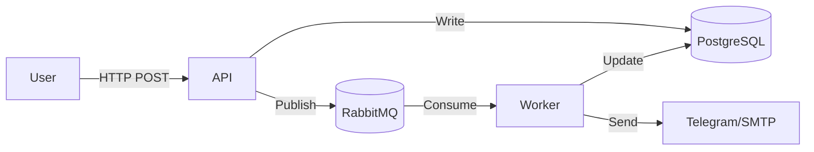

# NotifyService

## 1. Описание проекта
Необходимо разработать сервис для асинхронной отправки уведомлений пользователям. Сервис должен принимать запросы через HTTP API, помещать их в очередь сообщений, а отдельный воркер должен забирать задачи из очереди и отправлять уведомления (Email или Telegram).

**Главная цель:** Изучить работу с очередями сообщений (RabbitMQ), понять паттерн Producer-Consumer, реализовать обработку ошибок и повторные попытки (retry).

---

## 2. Стек технологий
| Компонент            | Технология              |
| :------------------- | :---------------------- |
| **Язык**             | Go                      |
| **Брокер сообщений** | RabbitMQ                |
| **База данных**      | PostgreSQL              |
| **Контейнеризация**  | Docker & Docker Compose |
| **HTTP Фреймворк**   | Gin / Echo / Chi        |
| **Конфигурация**     | ENV                     |

---

## 3. Архитектура
Система состоит из двух частей (могут быть в одном репозитории):
1.  **API Service (Producer):** Принимает HTTP запросы, валидирует их, сохраняет статус в БД и отправляет задачу в RabbitMQ.
2.  **Worker Service (Consumer):** Слушает очередь RabbitMQ, отправляет уведомление через внешний провайдер (SMTP/Telegram), обновляет статус в БД.

---

## 4. База данных (PostgreSQL)
Необходимо создать таблицу для хранения истории уведомлений.

**Таблица: `users`**

| Поле               | Тип            | Ограничения                                   | Описание                         |
| ------------------ | -------------- | --------------------------------------------- | -------------------------------- |
| `id`               | `BIGINT`       | `PRIMARY KEY`, `GENERATED ALWAYS AS IDENTITY` | Уникальный ID                    |
| `full_name`        | `VARCHAR(100)` | `NOT NULL`                                    | Имя пользователя                 |
| `email`            | `VARCHAR(255)` | `NOT NULL`, `UNIQUE`                          | Почта (для логина и уведомлений) |
| `password_hash`    | `VARCHAR(255)` | `NOT NULL`                                    | Хеш пароля (bcrypt/argon2)       |
| `telegram_chat_id` | `VARCHAR(100)` |                                               | ID для отправки в Telegram       |
| `phone`            | `VARCHAR(20)`  |                                               | Номер для SMS                    |
| `is_active`        | `BOOLEAN`      | `DEFAULT TRUE`                                | Активен ли пользователь          |
| `created_at`       | `TIMESTAMPTZ`  | `DEFAULT NOW()`                               | Время создания                   |
| `updated_at`       | `TIMESTAMPTZ`  | `DEFAULT NOW()`                               | Время обновления                 |

**Таблица: `notifications`**

| Поле            | Тип            | Ограничения                                    | Описание                              |
| --------------- | -------------- | ---------------------------------------------- | ------------------------------------- |
| `id`            | `BIGINT`       | `PRIMARY KEY`, `GENERATED ALWAYS AS IDENTITY`  | Уникальный ID                         |
| `user_id`       | `BIGINT`       | `NOT NULL`, `FOREIGN KEY REFERENCES users(id)` | Ссылка на пользователя                |
| `recipient`     | `VARCHAR(255)` | `NOT NULL`                                     | Конкретный получатель (email/chat_id) |
| `channel`       | `VARCHAR(20)`  | `NOT NULL`                                     | Тип: `email`, `telegram`, `sms`       |
| `message`       | `TEXT`         | `NOT NULL`                                     | Текст сообщения                       |
| `status`        | `VARCHAR(20)`  | `NOT NULL`, `DEFAULT 'pending'`                | `pending`, `sent`, `failed`           |
| `attempt_count` | `INT`          | `DEFAULT 0`                                    | Количество попыток отправки           |
| `error_message` | `TEXT`         |                                                | Текст ошибки, если статус `failed`    |
| `external_id`   | `VARCHAR(255)` |                                                | ID сообщения у провайдера             |
| `created_at`    | `TIMESTAMPTZ`  | `DEFAULT NOW()`                                | Время создания                        |
| `updated_at`    | `TIMESTAMPTZ`  | `DEFAULT NOW()`                                | Время обновления                      |

---
## 5. Логика работы (Business Logic)

### API Service
1.  Получить JSON из запроса.
2.  Проверить валидность (канал только `email` или `telegram`, сообщение не пустое).
3.  Создать запись в БД со статусом `pending`.
4.  Опубликовать сообщение в RabbitMQ.
5.  Если публикация успешна → вернуть `202 Accepted`.
6.  Если ошибка БД или очереди → вернуть `500 Internal Server Error`.

### Worker Service
1.  Подключиться к очереди `notifications_queue`.
2.  Получать сообщения (prefetch count = 1, чтобы не брать лишнего).
3.  **Обработка:**
    *   Если `channel == telegram` → отправить через Telegram Bot API.
    *   Если `channel == email` → отправить через SMTP (можно использовать gmail smtp для теста).
4.  **Успех:**
    *   Обновить статус в БД на `sent`.
    *   Отправить `ACK` в RabbitMQ (подтвердить обработку).
5.  **Ошибка:**
    *   Увеличить `attempt_count`.
    *   Если попыток < 3 → Отправить `NACK` с повторной постановкой в очередь (Requeue).
    *   Если попыток >= 3 → Обновить статус в БД на `failed`, отправить `ACK` (чтобы убрать из очереди, но не терять лог).

---
## 6. Требования к реализации

### 6.1. Конфигурация
*   Все настройки (порты, строки подключения к БД, RabbitMQ, токены телеграма) должны выноситься в **переменные окружения (.env)**.
### 6.2. Логирование
*   Использовать структурированный логгер (например, `zap` или `logrus`).
*   Логировать: начало обработки, успех, ошибку (с текстом ошибки).
*   Пример лога: `{"level": "error", "msg": "failed to send telegram", "error": "timeout", "id": "uuid..."}`

### 6.3. Graceful Shutdown
*   При остановке приложения (Ctrl+C) воркер должен корректно завершить текущую задачу и закрыть соединения с БД и RabbitMQ.

### 6.4. Docker Compose
*   Проект должен подниматься одной командой: `docker-compose up`.
*   В compose файле должны быть сервисы: `api`, `worker`, `postgres`, `rabbitmq`.

---

## 7. План разработки (Чек-лист)

- [ ] **Подготовка:**
    - [ ] Инициализировать Go модуль.
    - [ ] Написать `docker-compose.yml` для БД и RabbitMQ.
    - [ ] Поднять контейнеры, проверить доступность.
- [ ] **База данных:**
    - [ ] Написать SQL миграцию для таблицы `notifications`.
    - [ ] Реализовать подключение к БД в Go.
- [ ] **API Service:**
    - [ ] Сделать HTTP сервер.
    - [ ] Реализовать endpoint `/notify`.
    - [ ] Настроить подключение к RabbitMQ (Publisher).
    - [ ] Настроить запись в БД.
- [ ] **Worker Service:**
    - [ ] Настроить подключение к RabbitMQ (Consumer).
    - [ ] Реализовать логику отправки в Telegram (можно мокать/заглушку).
    - [ ] Реализовать логику отправки Email (можно логировать в консоль для теста).
    - [ ] Настроить обновление статуса в БД.
- [ ] **Надежность:**
    - [ ] Добавить счетчик попыток (Retry logic).
    - [ ] Добавить обработку ошибок (чтобы воркер не падал при ошибке отправки).
    - [ ] Реализовать Graceful Shutdown.
- [ ] **Финал:**
    - [ ] Написать README (как запустить, какие env переменные нужны).
    - [ ] Почистить код (linters).

